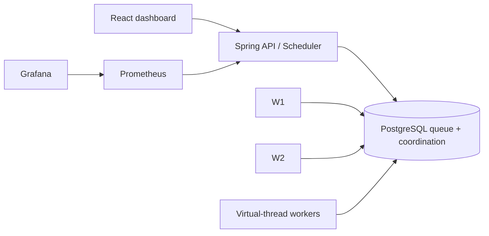

# Chronos

Distributed PostgreSQL-backed job scheduler and workflow prototype.

Run `docker compose up --build`, then open http://localhost:15173. The API is on port 18080, Prometheus on 19090 and Grafana on 13000 because the default host ports were already occupied on the setup host. PostgreSQL stays internal to the Compose network. Run `bash scripts/demo.sh` after the stack is healthy.

The queue uses `FOR UPDATE SKIP LOCKED`, worker leases, reaping, and per-job running-count admission. API errors for invalid workflow graphs are RFC 7807-style 422 responses.
