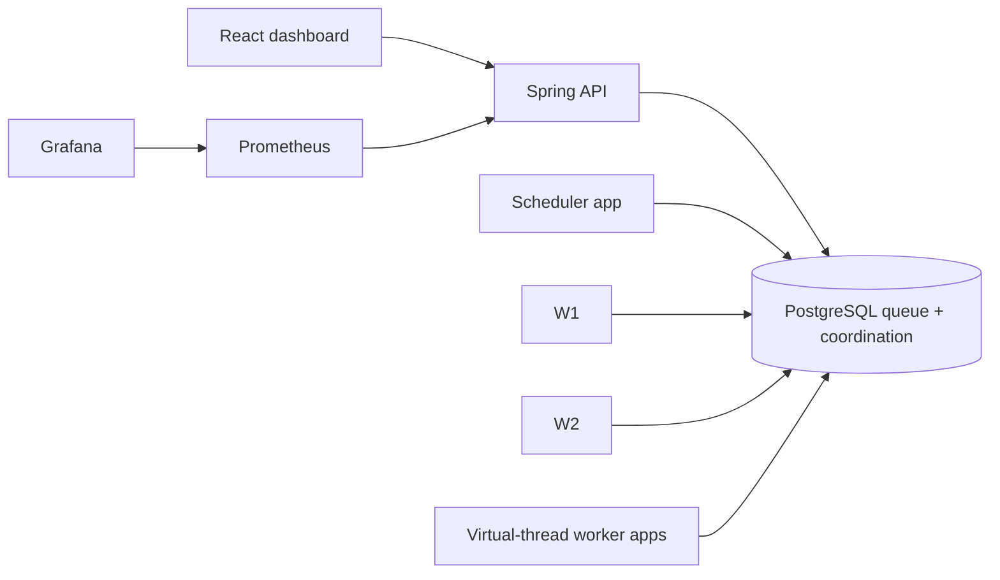

# Chronos

## Project structure

- `common` contains shared run status and execution context types.
- `core` owns job, run, workflow, scheduler, and worker domain services and PostgreSQL repositories. Flyway migrations live in `core/src/main/resources/db/migration` and currently run from the API application.
- `handlers` contains the job handler SPI and built-in handlers.
- `api` serves the HTTP API, SSE stream, and metrics.
- `scheduler` contains cron and workflow progression.
- `worker` claims and executes queued runs.
- `frontend` is the React/Vite console.

Compose builds three distinct Spring Boot applications from the shared Dockerfile: `api` owns the REST API, metrics, and Flyway migrations; `scheduler` advances cron fires and workflows; `worker` claims and executes runs. Three worker containers run as headless processes without HTTP listeners.

Distributed PostgreSQL-backed job scheduler and workflow prototype.

Run `docker compose up --build`, then open http://localhost:15173. The API is on port 18080, Prometheus on 19090 and Grafana on 13000 because the default host ports were already occupied on the setup host. PostgreSQL stays internal to the Compose network. Run `bash scripts/demo.sh` after the stack is healthy.

The queue uses `FOR UPDATE SKIP LOCKED`, worker leases, reaping, and per-job running-count admission. API errors for invalid workflow graphs are RFC 7807-style 422 responses.
