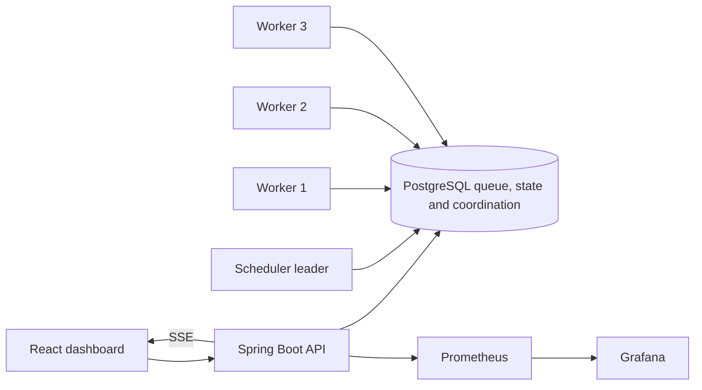

# Architecture

The API owns REST, authentication boundaries, SSE, and Flyway startup. The scheduler coordinates due jobs and workflow progression through PostgreSQL. Workers claim work with row locks and leases, so PostgreSQL is both queue and coordination store. `common` contains pure Java state primitives; `core` contains shared persistence and application services; `handlers` contains the handler SPI and built-ins.
